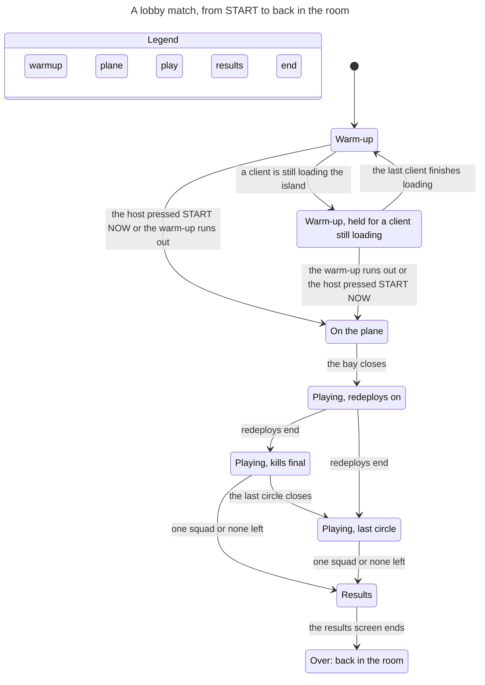

# Verify match phases

A lobby match must end: while it runs, its lobby's 60 Hz loop runs and its players cannot start another. The phase
logic sits in one long function (`Match.step`, shared/sim/match.ts) with satellite flags (`skipWarmup`, `warmWall`,
`warmHeldS`, `resurgenceOn`, `over`) and a hold the host wires in (`MatchHost.holdForStream`, shared/net/host.ts). The
only test is one 50-bot match on one seed. This skill checks every order of events in a small TLA+ model.

## The rules (tools/formal/MatchPhases.tla)

| Rule | In plain words | If it breaks |
|---|---|---|
| PhaseOrder | Phases change only Warmup to Plane to Play to Results, and Results to Warmup in practice. | Clients show a phase they have no state for. |
| WarmupBounded | A warm-up never lasts longer than a full warm-up, however long a client streams the island. | One slow client holds 49 others on the islet. |
| OneWinner | The results screen has one squad left, or none. | Results with two squads still alive. |
| OverFromResults | A match is over only from its results screen. | Players are sent to the room mid-match. |
| MatchEnds | A started lobby match ends (`m.over`, then `Lobby.endMatch`). | A lobby is stuck in a match forever. |
| PlayEnds | Every Play reaches its results, in practice too. | A practice match never ends. |

MatchEnds and PlayEnds assume what the code does not decide alone: the clocks keep running, and the last storm circle
(radius 0, 20 damage a second) wipes every squad still in it sooner or later. The model states these as fairness in
`Fairness`.

## Run it

```sh
node tools/formal/tlc.mjs MatchPhases --mutants
```

It needs Java 11 or newer on PATH. The first run downloads the pinned TLA+ tools jar (version and SHA-256 in
tools/formal/tlc.mjs) into node_modules/.cache. A run takes about 5 seconds: 3 squads, solo rules, about 1,800
distinct states. Expected output: `PASS MatchPhases` and one `PASS ... mutant` line for each entry in
tools/formal/MatchPhases.mutants.json, exit 0. Each mutant takes one guard out of a scratch copy and must make TLC report
the rule its entry names. A mutant that still passes means the model no longer sees that guard: fix the model.

On Windows, tlc.mjs suggests `winget install Microsoft.OpenJDK.21`. Microsoft's portable JDK zip also works without an
installer: unzip it and put its `bin` folder on PATH. On Windows on ARM, use the aarch64 build
(`https://aka.ms/download-jdk/microsoft-jdk-21-windows-aarch64.zip`), which runs natively. There the run took 5 s.

To check trios rules too, copy the model and its config to a scratch folder, set `Trios = TRUE` there, and run TLC on
the copy the same way; both pass at the commit below.

## The chart

Drawn with the pstack `/statechart` skill from a scratch copy of the model, with the config and view below (smaller
constants, so the graph fits the chart budget). Steps that stay in one box are hidden, and so are the squad wipes and
redeploys, the storm's first step, and START NOW pressed while the warm-up waits.



Read it as: a lobby match always runs top to bottom to "Over". The only loop is in the warm-up, while a client is still
loading the island, and the warm-up runs out after WARMUP_S whichever box it is in. Redeploys always end before the
results, because in solo a squad that is down is still counted while it waits to redeploy.

Chart config (`MatchPhases.cfg` in the scratch folder):

```
CONSTANTS
  Squads = {s1, s2}
  W = 2
  Lead = 1
  Cap = 1
  PlaneLen = 1
  R = 1
  EndAfterResults = TRUE
  Trios = FALSE
SPECIFICATION Spec
INVARIANTS
  WarmupBounded
  OverFromResults
PROPERTIES
  PhaseOrder
  MatchEnds
  PlayEnds
```

View (`view.ts`, passed with `--view`):

```ts
export const title = "A lobby match, from START to back in the room";
export const state = (v: any) => {
  if (v.over) return "Over: back in the room";
  if (v.phase === "warmup") return v.held > 0 && v.streaming ? "Warm-up, held for a client still loading" : "Warm-up";
  if (v.phase === "plane") return "On the plane";
  if (v.phase === "play") return v.res ? "Playing, redeploys on" : v.storm === 2 ? "Playing, last circle" : "Playing, kills final";
  return "Results";
};
export const group = (v: any) => (v.over ? "end" : v.phase);
export const colors = { warmup: "yellow", plane: "blue", play: "orange", results: "purple", end: "teal" };
export const step = (a: string, from: any, to: any) => {
  if (a === "WarmTick") return to.phase === "plane" ? (from.skip ? "the host pressed START NOW" : "the warm-up runs out") : to.held > from.held ? "a client is still loading the island" : null;
  if (a === "Stream") return from.streaming ? "the last client finishes loading" : null;
  if (a === "PlaneTick") return "the bay closes";
  if (a === "ResOff") return "redeploys end";
  if (a === "Storm") return to.storm === 2 ? "the last circle closes" : null;
  if (a === "End") return "one squad or none left";
  if (a === "ResultsTick") return "the results screen ends";
  return null;
};
```

## When the check fails

Read the result with `/statechart` (a scratch copy of the model, the config, the view above): it gives the shortest
path to each broken rule in plain words, and for MatchEnds or PlayEnds a loop that goes on forever. Then decide:

- **A real bug.** The path is a sequence of real ticks and messages. Replay it against the code: a headless match
  (`npx tsx tools/sim-smoke.mts solo 7 --check`), or a local server with `KR_EVENT_MODE=0 npm run server` and
  `KR_WARMUP_S` to stretch the warm-up. If it reproduces, report it with the path and the replay. Do not weaken the
  rule.
- **A modelling error.** The path takes a step the code cannot take. Fix the model, citing the code line.

## Keep the model in step with the code

| Code | Model action |
|---|---|
| match.ts `step`: the warm-up branch (`phaseT`, `warmWall`, `holdWarmup` through `warmupHeld`, `skipWarmup`, `enterPlane`) | WarmTick, HoldOn |
| match.ts `startNow`; server/index.ts onJSON "start" during a match (`Lobby.start` before one) | StartNow |
| host.ts `holdForStream`; server/index.ts onJSON "stream" | HoldOn, Stream |
| match.ts `stepPlane`, `enterPlay` | PlaneTick |
| storm.ts `stormAt` and `PHASE_REF` (which phases keep resurgence) | Storm |
| match.ts `step`: the resurgence block | ResOff |
| match.ts `kill`, `eliminate`, `squadsLeft` | Wipe, SquadsLeft |
| match.ts `stepRespawns` | Redeploy |
| match.ts `checkEnd`, `enterResults` | End |
| match.ts `step`: the Results branch (`RESULTS_S`, `endAfterResults`, `over`); server/lobby.ts `Lobby.pump`, `endMatch` | ResultsTick |

Coverage record: tools/formal/MatchPhases.covers.json names the code this model describes (one region per function,
method or switch case in the table above) and the writes it guards, and records a token hash of each region as of the
last run that passed. npm test's `formal` check (tools/formal/drift.mjs, no Java) fails when a region changed, moved or
vanished, when the model's own files changed, or when code outside the regions writes the guarded state. Then read each
change against the table: if the code changed shape, change the model and cite the line; if a function moved or a new
one writes the state, update the regions or the `allow` list (a function, the exact writes it may make there, and why). Re-verify and record in one step:

```sh
node tools/formal/tlc.mjs MatchPhases --mutants --record
```

It writes the hashes only when the model and every mutant pass, so a model can't be marked verified without TLC.
The pstack `/maintain-formal-verification-skill` skill walks through a larger catch-up.

## What it does not cover

Positions, health, loot and the economy are left out. The economy's buy-back revives a kong only while a squadmate is
alive, so it never brings an eliminated squad back and cannot stop a match ending. Solo redeploy limits are left out;
they only make the end come sooner. `checkEnd`'s `time > 5` is left out because the plane alone takes longer. The
storm's geometry is reduced to three steps. Firing-range matches (`range`) never end and are not modelled.
