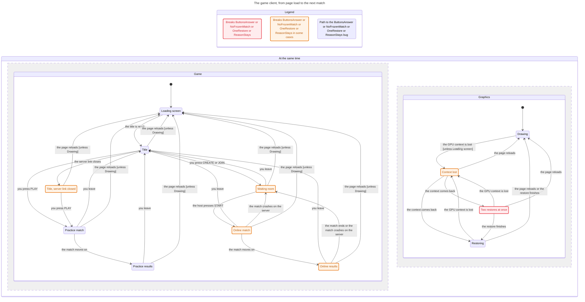

# The game client's lifecycle

This chart shows the client from page load to the next match: the loading screen, the title, a practice match, an online
room and match, and, beside them, the WebGL context (lost, restoring, back). It is drawn from the TLA+ model
`tools/formal/ClientLifecycle.tla` by the pstack `/statechart` skill, with every rule switched on, so TLC also marks the
states where a rule breaks. The `verify-client-lifecycle` skill (`.agents/skills/verify-client-lifecycle/`) says how
to run the check and keep the model in step with the code.

The model covers `client/src/game/index.ts` (`offline`, `online`, `wire`, `onJSON`, `enterMatch`, `exitToRoom`,
`leaveAll`), `client/src/game/render.ts` (the `GameRender` and its `match` resource scope),
`client/src/engine/res/restore.ts` and `restore-run.ts` (context loss and restore), and the messages
`server/lobby.ts` sends the client (AFK removal, a crashed match, the end of a match). One player, one tab. A link
that drops mid-match and the reconnect card are left out.

Red states break a rule on every path through them, orange ones on some paths. Blue edges are the shortest path to a
broken rule.

## The rules

| Rule | In plain words | Holds today? |
|---|---|---|
| NoMatchWithoutRenderer | A match on screen always has its renderer. | Yes |
| LeaveFreesTheSeat | Once you are back on the title, the server no longer holds a seat in a match for you. | Yes |
| ScopeHasOwner | The match's resource scope is open only while a match view owns it, so the next PLAY can open its own. | Yes |
| ButtonsAnswer | Pressing PLAY, CREATE or JOIN always does something you can see. | No: CREATE after the socket closed at the title |
| NoFrozenMatch | A match on screen is one the server still plays for you. | No: removed for inactivity |
| ReasonStays | When the server ends your match with a reason, the reason stays on screen until you move on. | No: a crashed match |
| OneRestore | One context restore at a time. | No: lose, restore, lose, restore |

`tools/formal/ClientLifecycle.cfg` checks the three rules that hold, so `node tools/formal/tlc.mjs ClientLifecycle` passes
and catches a regression in them. `tools/formal/ClientLifecycle.findings.cfg` checks all seven; it is what this chart
and the paths below come from.

## The paths that break a rule

1. **Enter on the loading screen** (ScopeHasOwner, ButtonsAnswer), fixed. The loading screen swallowed clicks but not
   Enter, so Enter reached PLAY (or JOIN on an invite link) before the prefabs existed: `GameRender` opened the `match`
   scope, threw on the missing view model, and left the scope open, so every later PLAY failed with "already has a live
   child named match" (and on a load over 120 s the loading screen's watchdog showed "THE ISLAND COULDN'T LOAD"). Now
   `prepareIsland` waits for `dataset.ready`, so a PLAY, CREATE or JOIN asked for during the load (Enter, a controller, a
   focused button) starts once the title is ready; the model's PLAY and CREATE/JOIN need the prefabs, and ScopeHasOwner holds; the mutant "PLAY runs before ready" puts the
   old guard back and breaks it.
2. **Removed for inactivity** (NoFrozenMatch), 5 steps: title, CREATE, START, then 180 s with no input. The server
   sends `REMOVED FOR INACTIVITY` without `afk: true` and no room frame. The client shows the text over a match that
   no longer updates.
3. **A crashed match** (ReasonStays), 5 steps. The server sends `MATCH CRASHED` and then the room frame, whose handler
   clears `lobbyState.error` as it returns to the room, so the reason can vanish before you read it.
4. **CREATE after the socket closed at the title** (ButtonsAnswer). A failed JOIN leaves a socket open at the title;
   the server closes it after 10 minutes idle, and `online()` reuses the closed link. CREATE sends nothing and shows
   nothing.
5. **Two restores at once** (OneRestore), 5 steps: lose, restore, lose, restore. Nothing stops a second
   `restoreAll` while the first is still running; only its final bookkeeping checks for a newer loss.

A path in the model is a lead, not a bug report. Each one is confirmed or refuted by running the real game (see the
skill), and the pull request that adds this chart says which.

## What Ray should check

- On a slow load, press Enter before the title appears, then press PLAY once it does. Does a practice match start?
- Start an online match in a private room and leave it without touching anything for 3 minutes. What does the screen
  show afterwards, and is there a way back to the room other than Leave?
- Type a wrong code into JOIN, wait 10 minutes on the title, then press CREATE. Does anything happen?
- Is the chart's order of screens how you think of the game? A screen you know but cannot find here is a gap in the
  model.
