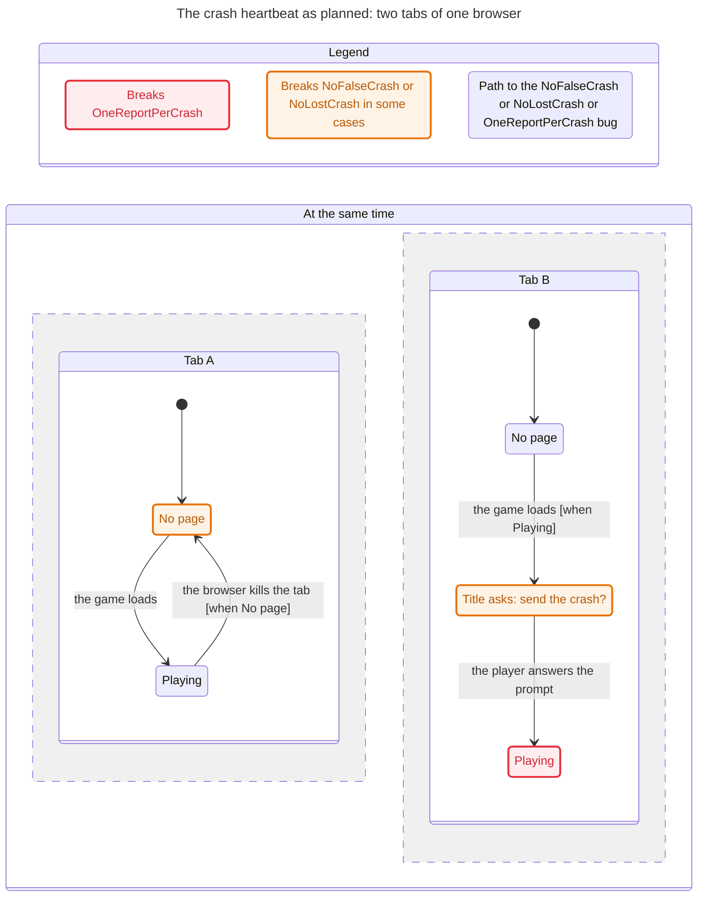
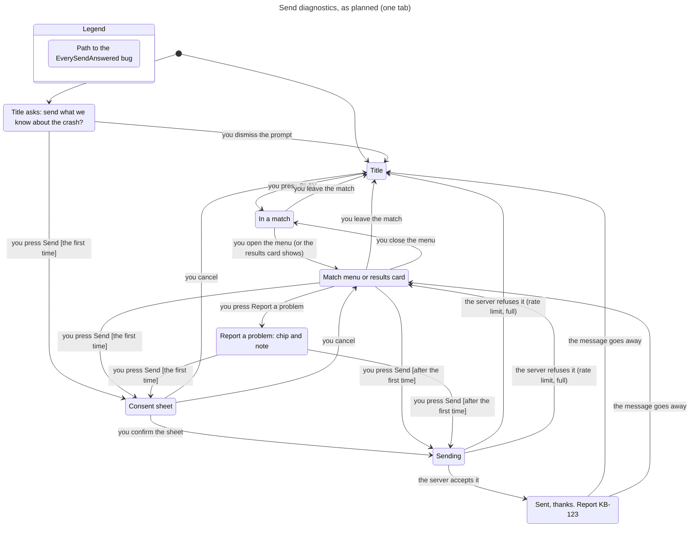

# Player diagnostics (KONG-71), as planned

KONG-71 plans a way for players to send what the game knows when something goes wrong: a Send diagnostics button in the
match menu and on the results card, Report a problem with a short note, a consent sheet the first time, an opt-in
automatic summary, and a crash prompt on the title after a session that died. Nothing of it is built yet. Two TLA+
models check the design as written, before any code exists, so the bugs they find cost a sentence in the plan instead of
a release. The `verify-diagnostics` skill (`.agents/skills/verify-diagnostics/`) says how to run them and how to
keep them in step once the code lands.

## The crash heartbeat (tools/formal/DiagHeartbeat.tla)

The plan: every 5 s the page writes a heartbeat to `localStorage` and marks it clean on `pagehide`. On the next load, a
heartbeat with no clean exit means the last session died, so the title asks "Send what we know?" (and, with the
automatic setting on, sends a summary at once).

The model runs two tabs of one browser profile, which share `localStorage`, through every order of loads, beats, closes,
kills, back/forward-cache freezes and thaws, and prompt answers. With one heartbeat record (`Design = "plan"`), all
three rules break:

| Rule | In plain words | The design as written |
|---|---|---|
| NoFalseCrash | The title never says your last session closed unexpectedly about one that is still open, or ended cleanly. | Breaks in 3 steps: tab A plays and beats, tab B loads, sees A's record "not clean", and asks about a crash that did not happen. |
| NoLostCrash | A session that dies is picked up by a later load; until then the evidence stays in `localStorage`. | Breaks in 2 steps: a tab killed before its first beat (up to 5 s after load) leaves no record. It also breaks when a live tab's next beat or clean exit overwrites a dead tab's record. |
| OneReportPerCrash | One crash is reported at most once. | Breaks in 4 steps: the automatic summary and the prompt's Send each report the same crash, and two tabs can both pick it up. |

The fix the model checks (`Design = "locks"`, in `DiagHeartbeat.cfg`), and all three rules hold with it:

1. One heartbeat record per session (`kr.hb.<session id>`), not one shared record, written as the page loads rather
   than at its first beat.
2. Each live page holds a Web Lock named after its session (`navigator.locks.request`, held until the page dies). A
   load calls a record "dead" only if its session holds no lock, and claims it so a second tab does not ask too.
3. `pageshow` from the back/forward cache marks the record running at once, without waiting for the next 5 s beat.
4. The crash bundle carries the dead session's id, so triage merges the prompt's send with the automatic summary of
   the same crash.

## Sending (tools/formal/DiagSend.tla)

One tab: the title (with or without the crash prompt), a match, the match menu or results card, the consent sheet,
Report a problem's note, and what you see after a send. The server can accept an upload or refuse it (rate limit: 20
per address per 10 minutes and 300 per hour; a full spool or bundle folder).

| Rule | In plain words | The design as written |
|---|---|---|
| NoManualSendWithoutConsent | Nothing a player sends by hand leaves the browser before they confirmed the consent sheet once. | Holds |
| CallsignOnlyWhenTicked | The callsign goes only in a send where "Include my callsign" was ticked; an automatic summary never has it. | Holds |
| AutoOnlyWhenOn | Automatic summaries go only while the setting is on. | Holds |
| EverySendAnswered | Every send ends with something on screen: the thank-you with the report id, or a message that it did not go. | Breaks in 3 steps: a refused upload returns to the previous screen without a word. |
| SendEnds | A send never hangs: the player sees one of the two in the end. | Breaks the same way, and also needs a request timeout the plan does not mention. |

The fix is two sentences in the plan: a refused send shows "Not sent: try again in a few minutes" (`RefusedShown =
TRUE`, in `DiagSend.cfg`), and an upload with no answer within a timeout counts as refused. The model assumes the
second (a fairness condition on the answer); its mutant "a stalled upload" takes it out, and SendEnds breaks. A timed-out
upload may still have reached the server, so the bundle should carry an id the client makes once per send, and the
server should treat a retry with the same id as the same report. The model does not tell the two kinds of refusal
apart; that id is what keeps a retry from becoming a second report.

## What Ray should check

- Do you play with the game open in two tabs (or a tab plus a pop-out)? If so, the single-record heartbeat would ask
  you about crashes that never happened. Is the Web Lock fix the right one, or should the crash prompt only ever look
  at the tab that died?
- Should a crash the automatic summary already sent still show the prompt (with Send merged into the same report), or
  should the prompt skip crashes already reported?
- What should a refused send say, and should it offer to keep the bundle and retry later?
- Does the send chart match the screens you expect, including where each one returns you after the thank-you?
