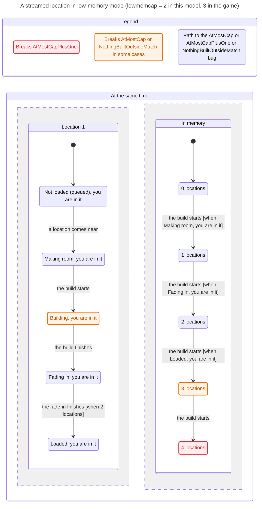

# POI streaming and eviction in low-memory mode

In low-memory mode (on by default in Safari and on devices that report under 8 GB, `client/src/low-mem-device.ts`) the
client does not build every location at boot. During a match it builds the nearest queued location, and before each
build it evicts the farthest live one. Distance is horizontal, from where the camera will be 5 s ahead (`distM`), so
the location ahead builds first and the ones behind are the first evicted. On the plane the build range also counts
height above the pad. Before RAY-272 that held for the whole descent too, so from the parachute nothing ahead built until
the player was about 450 m from it in a straight line; now it stops counting height once the player falls or glides while the list would go over `lowmemcap` (3) or the `lowmembudget` estimate
(1500 MB). This is what keeps a 16 GB Mac's Safari tab alive. Desktop Chrome builds every location once and keeps it,
so none of this runs there.

The TLA+ model `tools/formal/PoiResidency.tla` checks every order of camera moves, jumps and landings, builds, fade-ins,
evictions and match starts and ends for four locations with a cap of 2. Each location's distance is one of four
classes in the order the code ranks them: you are in it, the glide heads for it ("ahead", only while falling or gliding), near,
far. `MaxInside` says how many location circles the camera can stand in
at once: 1, or 2, because some circles overlap on the map. The `verify-poi-residency` skill
(`.agents/skills/verify-poi-residency/`) says how to run it.

## One location's life

Drawn from the model's actions: `nextNearModule` picks it, `trimStreamed` makes room, `buildStreamed` builds it,
`integrateFresh` fades it in, and an eviction (by the loop's own trim or the 2 s timer) sends it back to the queue.

```mermaid
stateDiagram-v2
  direction LR
  queued: Queued (not in memory)
  trimming: Making room
  building: Building
  integrating: Fading in
  live: Live
  [*] --> queued
  queued --> trimming: in a match, it is the nearest queued location (while gliding, height no longer counts)
  trimming --> building: the list is under the cap, or nothing more can be evicted
  building --> integrating: build() returns
  integrating --> live: the fade-in finishes
  live --> queued: evicted (farthest first, never the one you are in; behind the glide before ahead of it)
```

## The paths that break a rule

TLC reaches 177,633 states with `MaxInside = 2`, too many to draw, so the chart below draws only the shortest path to
each broken rule, made by the pstack `/statechart` skill.

Three things put more than `lowmemcap` locations in memory, or start a build where none should be:

1. **A build while every resident is protected** (AtMostCap, 13 steps with `MaxInside = 1`). With a cap of 2, you
   stand in one live location while a second is still fading in. Neither can be evicted: `evictionsFor` keeps the one
   you stand in, and a fading-in location counts as distance -Infinity. So the trim for a third finds nothing to evict,
   and the build goes ahead anyway: one over the cap until the fade-in ends and a later trim or the 2 s timer evicts.
   The back-pressure in `stream()` (the loop waits while two integrations are in flight) keeps it at one over, so
   AtMostCapPlusOne holds.
2. **Standing in two overlapping locations** (AtMostCap in 10 steps, AtMostCapPlusOne in 16). `evictionsFor` never evicts
   a location you stand in, by design, so with two kept that way the next build goes over the cap, and with a fade-in
   on top, two over.
3. **Leaving a match during a trim** (NothingBuiltOutsideMatch, 4 steps). `nextNearModule` only picks in a match, but
   `stream()` does not check the match again after the trim, so a location picked just before you leave is still
   built in the room or on the title.

## The rules

| Rule | In plain words | Holds today? |
|---|---|---|
| NoEvictWhileBuilding | A location is never thrown away while it is still building or fading in. | Yes |
| NothingPickedOutsideMatch | Nothing new is picked to build outside a match (title, room, results lobby). | Yes |
| GlideTargetFirst | While you fall or glide, the location you glide toward builds before any queued one behind you or to the side. | Yes (RAY-272) |
| GlideTargetKept | Making room never throws away the location you glide toward while one behind you or to the side stays. | Yes (RAY-272) |
| AtMostCapPlusOne | At most `lowmemcap` + 1 streamed locations hold memory, counting the one being built. | Only when you stand in one location at a time |
| AtMostCap | At most `lowmemcap` streamed locations hold memory, counting the one being built. | No: one over during a fade-in |
| NothingBuiltOutsideMatch | No build starts outside a match. | No: leaving during a trim |

`tools/formal/PoiResidency.cfg` (`MaxInside = 1`) checks the first five; `PoiResidency.findings.cfg` (`MaxInside = 2`)
checks all seven.

One more thing the model shows that is not a broken rule: nothing listens for the end of a match. After you leave, the
locations stay in memory and builds in flight finish; the 2 s timer only trims down to the cap.

## What Ray should check

- Is "one location over the cap while another builds or fades in" acceptable on a 16 GB Mac in Safari, or should the
  trim count the location still building, or make the next build wait?
- Standing where two locations overlap keeps both whatever the cap. Is that the right call?
- Should a location picked just before you leave a match still be built?
- Should leaving a match evict the streamed locations, so the title and the room hold less memory?
- Does the order of builds you see in Safari (nearest first, the one you are in never evicted, and from the parachute
  the location you are gliding toward first) match this chart?
