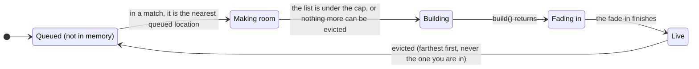
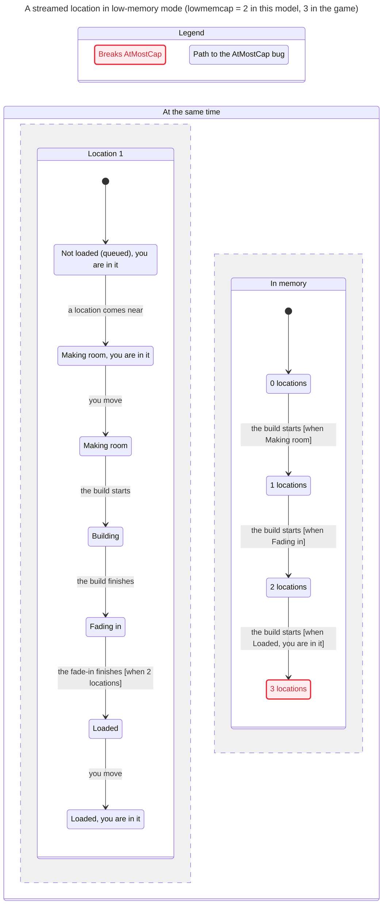

# POI streaming and eviction in low-memory mode

In low-memory mode (on by default in Safari and on devices that report under 8 GB, `client/src/low-mem-device.ts`) the
client does not build every location at boot. During a match it builds the nearest queued location, and before each
build it evicts the farthest live one while the list would go over `lowmemcap` (3) or the `lowmembudget` estimate
(1500 MB). This is what keeps a 16 GB Mac's Safari tab alive. Desktop Chrome builds every location once and keeps it,
so none of this runs there.

The TLA+ model `tools/formal/PoiResidency.tla` checks every order of camera moves, builds, fade-ins, evictions and match
starts and ends for four locations with a cap of 2. The `verify-poi-residency` skill
(`.agents/skills/verify-poi-residency/`) says how to run it.

## One location's life

Drawn from the model's actions: `nextNearModule` picks it, `trimStreamed` makes room, `buildStreamed` builds it,
`integrateFresh` fades it in, and an eviction (by the loop's own trim or the 2 s timer) sends it back to the queue.

## The path to more than lowmemcap locations in memory

TLC reaches 19,680 states, too many to draw, so the chart below draws only the shortest path that breaks the strict
rule, made by the pstack `/statechart` skill.

`trimStreamed` counts a location that is building or fading in, but only evicts live ones. A build that starts while
the previous one is still fading in therefore goes ahead with the list already full: for a short while the cap plus
one location holds memory. The back-pressure in `stream()` (the loop waits while two integrations are in flight) keeps
it at one over, never more.

## The rules

| Rule | In plain words | Holds today? |
|---|---|---|
| AtMostCapPlusOne | At most `lowmemcap` + 1 streamed locations hold memory, counting the one being built. | Yes |
| NoEvictWhileBuilding | A location is never thrown away while it is still building or fading in. | Yes |
| NothingBuiltOutsideMatch | Nothing new is built outside a match (title, room, results lobby). | Yes |
| AtMostCap | At most `lowmemcap` streamed locations hold memory, counting the one being built. | No: one over, briefly |

`tools/formal/PoiResidency.cfg` checks the three that hold; `PoiResidency.findings.cfg` adds AtMostCap.

One thing the model shows that is not a broken rule: nothing listens for the end of a match. After you leave, the
locations stay in memory and builds in flight finish; the 2 s timer only trims down to the cap.

## What Ray should check

- Is "at most one location over the cap, for the length of a fade-in" acceptable on a 16 GB Mac in Safari, or should
  the cap count the fading-in location as evictable or make the next build wait?
- Should leaving a match evict the streamed locations, so the title and the room hold less memory?
- Does the order of builds you see in Safari (nearest first, the one you are in never evicted) match this chart?
